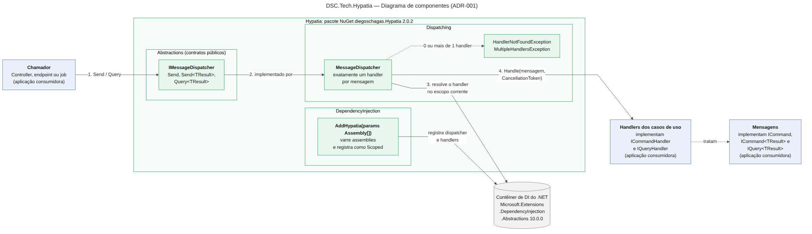
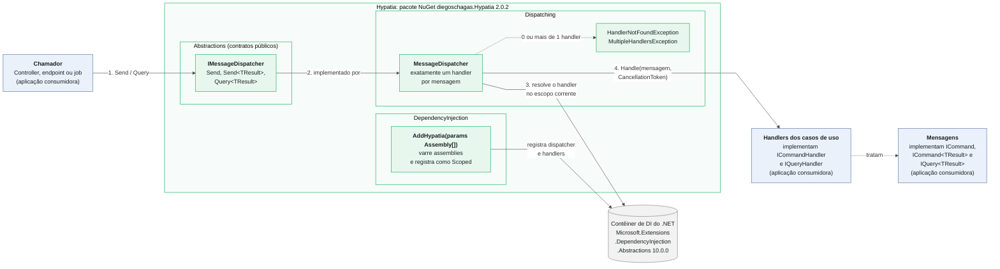

# Diagrama de componentes: DSC.Tech.Hypatia

**Decisão relacionada:** ADR-001, biblioteca própria e leve de mensageria e CQRS, sem dependência de MediatR (`ADR-001-Hypatia.docx`, 19/10/2026).
**Status:** rascunho em revisão pelo autor (Sprint 2, diagrama C4 nível 3 simplificado).
**Ferramenta:** Mermaid (gratuita e de código aberto). O diagrama é texto, então cada mudança aparece no histórico de commits.

## Leitura do fluxo

1. O chamador (controller, endpoint ou job) envia a mensagem ao `IMessageDispatcher` (`Send` ou `Query`).
2. `IMessageDispatcher` é implementado por `MessageDispatcher`, registrado pelo `AddHypatia` como Scoped.
3. O `MessageDispatcher` resolve o handler no escopo corrente do contêiner de DI do .NET.
4. Se houver exatamente um handler, o dispatcher invoca `Handle(mensagem, CancellationToken)`. Se houver nenhum ou mais de um, lança `HandlerNotFoundException` ou `MultipleHandlersException`.

O `AddHypatia(params Assembly[])` varre os assemblies informados e registra o dispatcher e os handlers no contêiner.

## Legenda

- **Verde:** componentes do Hypatia, agrupados nas camadas Abstractions, Dispatching e DependencyInjection.
- **Azul:** código da aplicação consumidora. As interfaces `ICommand`, `ICommand<TResult>`, `IQuery<TResult>`, `ICommandHandler` e `IQueryHandler` pertencem à camada Abstractions; no diagrama aparecem do lado da aplicação, que as implementa.
- **Cinza:** dependência externa (`Microsoft.Extensions.DependencyInjection.Abstractions` 10.0.0).

## Código-fonte do diagrama

Para editar: altere o bloco acima (ou o arquivo `hypatia-componentes.mmd`) e confira o resultado em https://mermaid.live. O GitHub renderiza blocos `mermaid` em arquivos Markdown.

## Arquivo draw.io: mapa do projeto e diagramas da Sprint 2

O arquivo `hypatia-mapa-do-projeto.drawio` tem 6 páginas e abre em https://app.diagrams.net/ (Arquivo > Abrir de > Dispositivo, ou arrastar o arquivo para a janela). É um rascunho em andamento e serve como evidência de execução.

| Página | Conteúdo |
| --- | --- |
| 1 · Mapa do projeto | Objetivo SMART, 3 sprints, situação de cada entrega (concluído, em andamento, planejado) e onde está cada evidência |
| 2 · C4 nível 1 | Contexto: pessoas, aplicação consumidora, GitHub, NuGet.org e contêiner de DI |
| 3 · C4 nível 2 | Contêineres e fluxo de distribuição, com a lacuna do `.consumer-test` fora do workflow |
| 4 · C4 nível 3 | Componentes da biblioteca: Abstractions, Dispatching e DependencyInjection |
| 5 · Sequência | Send com retorno (Send sem retorno e Query seguem o mesmo fluxo) |
| 6 · Sequência | Handler ausente ou duplicado, e registro com `AddHypatia` |

Para a evidência no relatório, abra cada página no draw.io e use Arquivo > Exportar como > PNG, ou tire um print com a barra de endereço visível.
